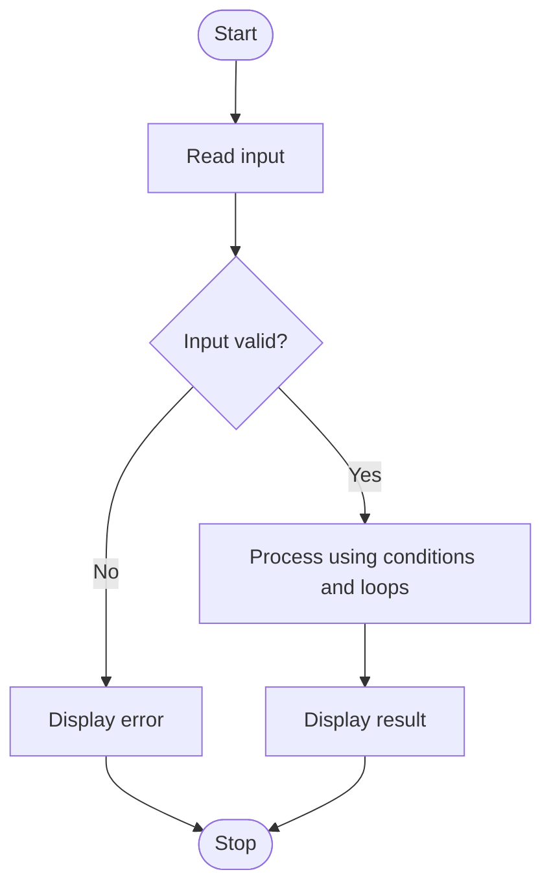

# 27. Advanced Numeric Pattern Generator

## Case study number
**27** (as numbered in the supplied Python Activity-Based Learning PDF)

## Problem statement
Generate a symmetric numeric diamond pattern for a user-supplied size and reject invalid dimensions.

## Objectives
- Use nested loops to generate a pattern.
- Control spacing and number sequences.
- Validate the requested size.

## Assumptions
- The size must be an integer from 1 to 9.
- The pattern grows from 1 to the selected size and then shrinks.

## Algorithm
1. Read the size.
2. If it is outside 1 to 9, display an error.
3. Use an outer loop to create the upper half including the middle row.
4. Print leading spaces and ascending then descending digits.
5. Use another loop to create the lower half.

## Flowchart


## Pseudocode
```text
START
INPUT size
IF size < 1 OR size > 9 THEN display error
ELSE FOR row from 1 to size
PRINT leading spaces, ascending digits, descending digits
FOR row from size-1 down to 1
PRINT matching lower rows
STOP
```

## Python source code
Run `python main.py` from this folder.

```python
print("NUMERIC DIAMOND PATTERN")
size = int(input("Enter pattern size (1 to 9): "))

if size < 1 or size > 9:
    print("Please enter a size from 1 to 9.")
else:
    for row in range(1, size + 1):
        for space in range(size - row):
            print(" ", end="")
        for number in range(1, row + 1):
            print(number, end="")
        for number in range(row - 1, 0, -1):
            print(number, end="")
        print()

    for row in range(size - 1, 0, -1):
        for space in range(size - row):
            print(" ", end="")
        for number in range(1, row + 1):
            print(number, end="")
        for number in range(row - 1, 0, -1):
            print(number, end="")
        print()
```

## Test cases

| Test | Input / condition | Expected result |
|---|---|---|
| 1 | size 3 |   1 / 121 / 12321 / 121 / 1 |
| 2 | size 1 | 1 |
| 3 | size 0 | Please enter a size from 1 to 9. |

## Sample output
```text
Enter pattern size (1 to 9): 3
  1
 121
12321
 121
  1
```

## Output screenshot
Run `main.py` in VS Code or a terminal and take a screenshot of the output for your submission. The sample output above is included as a text reference; it is not a screenshot.

## Conclusion
The pattern generator uses nested for loops, range, conditions, and formatted printing.
